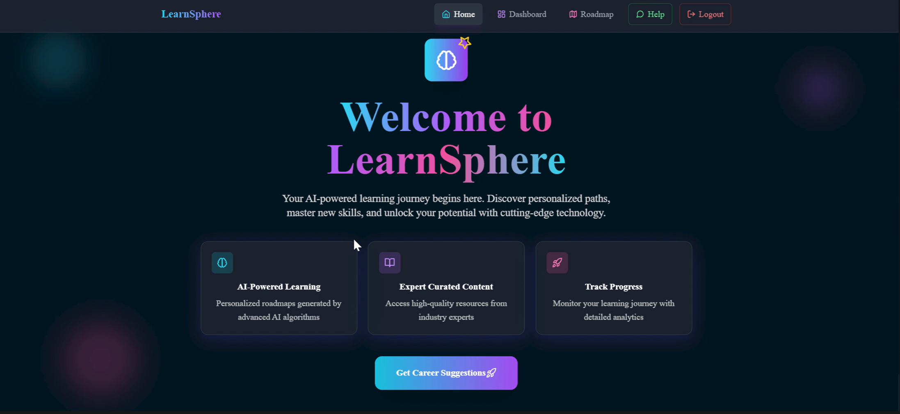
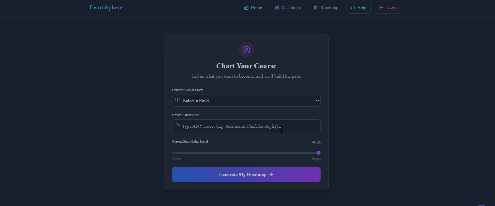
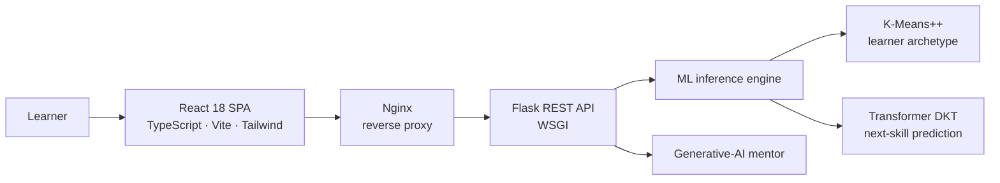

<div align="center">

# 🎓 LearnSphere

### An Agentic GenAI-Powered Personalized Learning Ecosystem

*Adaptive learning that understands how each student learns, and predicts what they need next.*


**B.Tech CSE (Data Science)** · Amity School of Engineering & Technology, Amity University Uttar Pradesh, Noida
**Minor Project (Sem VII) → Major Project (Sem VIII)** · Aug 2025 – Mar 2026 · Supervisor: Prof. (Dr.) Dolly Sharma

</div>

---

## ✨ Overview

Most online learning platforms serve every learner the same content in the same order. LearnSphere replaces that one-size-fits-all model with a system that **reads learner behaviour, forecasts the next skill a student will need, and guides them through an AI mentor**, all inside a polished full-stack web experience.

It began as the Semester VII Minor Project and grew, over two semesters into a complete ecosystem built by a team of three: a machine-learning engine, a resilient backend, and an immersive frontend.

---

## 📘 Bachelor's Thesis / Project

**Title of Bachelor's thesis/project:**
LearnSphere: An Agentic GenAI-Powered Personalized Learning Ecosystem

**Brief abstract of Bachelor's thesis/project:**
LearnSphere is a personalized learning platform that models how students learn and predicts the next skill each learner needs. In this team project of three, I developed the machine-learning engine. It combines K-Means++ and DBSCAN clustering on the Open University Learning Analytics Dataset (32,593 learners) to identify behavioural groups and filter noisy engagement data, with deep knowledge tracing on the EdNet dataset. I compared a Bidirectional LSTM baseline with a multi-head self-attention Transformer for next-skill prediction over 50 core STEM skills. The Transformer reached 26.1% accuracy against 23.4% for the baseline (2.0% by chance), converged in 10 instead of 28 epochs, and answered in about 12 ms instead of 45 ms, which makes real-time use practical. The engine is integrated with a Flask backend and a React frontend built by my teammates. The report also discusses limitations such as cold start and dataset bias.

---

## 🎬 Demo

**▶️ [Watch the full walkthrough](demo-walkthrough.mp4)**

| Interface Overview | Analytics Dashboard |
|---|---|
|  |  |

---

## 🏗️ System Architecture



1. The React client captures learner activity and sends it to the Flask API as JSON.
2. The backend hands the recent interaction sequence to the ML engine, which applies the same padding and masking used in training.
3. The engine returns a probability for each of the 50 tracked skills, and the most likely next skill drives the recommendation shown in the interface.
4. The generative-AI mentor answers questions through the backend's orchestration layer.

---
## 📚 Research Output

The project also contributed to a collaborative research manuscript co-authored by the LearnSphere team:

**“Agentic GenAI-Powered Personalized Learning: A Review and Framework”**  
*Submitted to WIREs Data Mining and Knowledge Discovery — Under Review*

**Project Supervisor:** Prof. (Dr.) Dolly Sharma


## 👥 Team & Contributions

Three engineers, three layers, one cohesive product.

---

### 📊 Joya Parveen · Machine Learning & Data Science &nbsp;·&nbsp; [GitHub](https://github.com/codebyj857)

> Designed and delivered the complete **predictive intelligence layer**, from raw clickstream logs to millisecond next-skill inference.

#### 🔹 Data Engineering at Scale
- Built the end-to-end ingestion and preprocessing pipeline for **two public datasets**: OULAD (**32,593 learners** across **22 module presentations**) and EdNet KT1.
- Fused three relational OULAD tables into a single feature vector per learner, applying min-max normalisation and median imputation to tame heavily skewed click distributions.
- Distilled the EdNet skill taxonomy from **4,217 to 50 core STEM skills**, time-ordered every interaction, and engineered padded, masked tensors over a **200-interaction look-back window**, cutting input sparsity from **98.4% to 12.5%** so the models train on a single consumer GPU.

#### 🔹 Behavioural Intelligence
- Engineered a two-stage clustering pipeline: **K-Means++** (k = 3, selected by grid search on the Silhouette coefficient) to discover learner archetypes, with **DBSCAN** as a density-based anomaly filter for extreme and unstable engagement patterns.
- Structured the educational feature-engineering and metric-extraction logic that feeds personalised recommendations and adaptive learning paths.

#### 🔹 Deep Knowledge Tracing
- Designed, trained and benchmarked **two sequence architectures** on 50-class next-skill prediction: a **Bidirectional LSTM** baseline and a **multi-head self-attention Transformer**, both optimised with Adam, dropout and early stopping.
- Delivered an attention-weight analysis (12-interaction heatmap) that exposes which past interactions drive each prediction.

#### 🔹 Production Hand-off
- Wrote `inference.py`, the entry point the Flask backend calls for real-time predictions, with lazy PyTorch loading so the project imports cleanly even without the ML stack.
- Authored the reusable figure-generation scripts and the complete research report covering methodology, evaluation and findings.
- Completed **15 of 15** weekly progress reports under faculty supervision.

#### 📈 Results

**Knowledge tracing (EdNet, 50 skills)**

| Model | Accuracy | AUC-ROC | Epochs to converge | Latency |
|---|---|---|---|---|
| Random baseline | 2.0% | 0.500 | n/a | < 1 ms |
| Bi-LSTM | 23.4% | 0.755 | 28 | ~45 ms |
| **Transformer** | **26.1%** | **0.901** | **10** | **~12 ms** |

The Transformer reaches **13× the random baseline**, adds **+2.7 points of accuracy** and **+0.146 AUC-ROC** over the Bi-LSTM, converges in **2.8× fewer epochs**, and serves predictions **3.75× faster**.

**Behavioural clustering (OULAD)**

| Metric | K-Means (k = 3) | After DBSCAN filtering | Change |
|---|---|---|---|
| Silhouette (higher is better) | 0.357 | 0.689 | **+93.0%** |
| Davies-Bouldin (lower is better) | 1.079 | 0.267 | **−75.2%** |
| Calinski-Harabasz (higher is better) | 1,452.3 | 3,105.8 | **+113.8%** |

*The clustering and knowledge-tracing models are trained on different datasets, so they are complementary components. At serving time the backend uses the saved K-Means model to assign a learner archetype and the Transformer to predict the next skill. Cluster-quality gains reflect noise removal.*

```bash
# Build a predictor and run a prediction on a skill sequence
python -c "from machine_learning.inference import get_predictor; p = get_predictor('transformer', num_skills=100); print(p.predict([[1,2,3]]))"

# Regenerate the report figures
python research_plot_generators/generate_clustering_plots.py
python research_plot_generators/generate_attention_heatmap.py
```

<details open>
<summary><b>📁 machine_learning/ structure</b></summary>

```text
machine_learning/
├── __init__.py
├── README.md
├── inference.py                  # Flask integration entry point (real-time predictions)
├── preprocessing/
│   ├── __init__.py
│   └── data_pipeline.py          # OULAD / EdNet ingestion, normalisation, sequence padding
├── clustering/
│   ├── __init__.py
│   └── behavioral_clustering.py  # K-Means++ and DBSCAN behavioural clustering
└── models/
    ├── __init__.py
    ├── transformer_dkt.py        # Multi-head self-attention Transformer (primary model)
    └── bilstm_baseline.py        # Bidirectional LSTM (benchmark baseline)
```

</details>

---

### 🛠️ Anushka Srivastava · Backend & Systems Engineering &nbsp;·&nbsp; [GitHub](https://github.com/ANUSHKA-USERNAME)

> Engineered the **robust, secure and deployable backbone** that connects every part of LearnSphere.

#### 🔹 Core Architecture & Systems Engineering
- Engineered the application backend and its **RESTful routing layers in Flask**, giving the React frontend and the ML inference engine a clean, well-structured contract.
- Built **production-grade containerisation and deployment workflows** with Docker multi-stage builds, an **Nginx reverse proxy** and a **WSGI application server** (Gunicorn).
- Designed the persistent data models behind learner accounts and user feedback.

#### 🔹 Reliability & Security
- Implemented backend **fault-tolerance mechanisms**, including **custom circuit breakers**, retry logic with backoff and request timeouts, so a slow or failing dependency degrades gracefully instead of cascading through the platform.
- Delivered **secure session management** and a **cryptographic password-hashing pipeline**, with CORS filtering and centralised exception handling protecting the API surface.

#### 🔹 AI Service Orchestration
- Built the **integration bridges** between core backend routes and the generative-AI pathways that power **dynamic content generation** and **automated mentor responses**.

| Layer | Technologies | Role |
|---|---|---|
| API | Flask, REST routing | Contract between frontend and ML engine |
| Runtime | Gunicorn (WSGI), Nginx | Production serving and reverse proxy |
| Packaging | Docker (multi-stage) | Reproducible builds and deployment |
| Resilience | Circuit breaker, retry with backoff, timeouts | Fault isolation |
| Security | Session management, password hashing, CORS | Protected sessions and API surface |
| AI | Generative-AI integration | Content generation and mentor responses |

<details open>
<summary><b>📁 backend/ structure</b></summary>

```text
backend/
├── app_simple.py                 # Flask application
├── wsgi.py                       # WSGI entry point
├── circuit_breaker.py            # Fault-tolerance logic
├── database_models.py            # Data models
├── hybrid_recommender.py         # Recommendation logic
├── verified_resources_manager.py # Verified learning-resource management
├── verified_resources.json
├── requirements.txt
├── models/
│   └── UserFeedback.py           # User feedback model
└── static/plots/
    ├── USER_FEEDBACK_DATA.py
    ├── test_user_performance_working.py
    └── user_feedbacks.json
```

</details>

---

### 💻 Arpita · Frontend & Visualisation &nbsp;·&nbsp; [GitHub](https://github.com/ARPITA-USERNAME)

> Crafted a **fast, fluid and immersive** client experience that turns complex learning analytics into something students want to open.

#### 🔹 Modern Frontend Architecture
- Engineered a high-performance **Single Page Application** with **React 18, TypeScript, Vite and Tailwind CSS**.
- Structured the client around **React Context and custom hooks** for state management, with **error boundaries** so a failing component never takes down the whole page.

#### 🔹 Immersive Visualisation & UI Design
- Implemented rich **analytics dashboards**, real-time **glowing progress charts** and a **glassmorphism** design system for a modern, high-contrast interface.
- Built persistent **3D WebGL scenes** with **Three.js and React Three Fiber** for a distinctive, memorable look.

#### 🔹 Client Experience & Navigation
- Designed seamless **client-side routing**, **protected authentication flows** and **interactive quiz modals**.
- Integrated **speech recognition** to make the experience more engaging and accessible.

| Layer | Technologies | Role |
|---|---|---|
| Framework | React 18, TypeScript, Vite | Fast, strictly typed single-page application |
| Styling | Tailwind CSS, glassmorphism | Responsive, consistent visual system |
| 3D / visuals | Three.js, React Three Fiber | Immersive WebGL scenes and charts |
| State | React Context, custom hooks | Auth, user and theme state |
| Experience | Routing, protected routes, quiz modals, speech recognition | Navigation and engagement |

<details open>
<summary><b>📁 frontend/ structure</b></summary>

```text
frontend/
├── index.html
├── package.json
├── package-lock.json
├── vite.config.js
├── tailwind.config.js
├── postcss.config.js
├── tsconfig.json
├── tsconfig.node.json
└── src/
    ├── main.tsx
    ├── App.tsx
    ├── index.css
    ├── components/
    ├── context/
    ├── pages/
    └── utils/
```

</details>

---

## 🚀 Running Locally

```bash
# Backend
cd backend
pip install -r requirements.txt
python app_simple.py

# Frontend (in a second terminal)
cd frontend
npm install
npm run dev
```

---

## 🗓️ Project Timeline

| Phase | Course | Credits | Period |
|---|---|---|---|
| Prototype | Minor Project, Semester VII | 4 | Aug 2025 – Nov 2025 |
| Full system and research report | Major Project, Semester VIII | 10 | Dec 2025 – Mar 2026 |

---

## 🔭 Scope & Next Steps

The 50-skill taxonomy and the cold-start case for brand-new learners define the current scope. Next steps include graph-based prerequisite modelling and meta-learning for faster personalisation.

---

## 🙏 Acknowledgements

With thanks to **Prof. (Dr.) Dolly Sharma** for her guidance throughout, and to the Department of Computer Science & Engineering, ASET, Amity University. Datasets: the Open University Learning Analytics Dataset (Kuzilek et al., 2017) and EdNet (Choi et al., 2020).

## 📄 License

Intended for academic and portfolio use. Please check the individual dataset licences before reuse.
